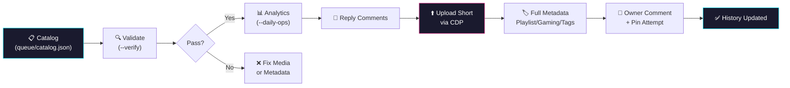

# YouTube Shorts Pro Skill

> A complete AI-agent operating system for building, upgrading, auditing, and running a monetizable YouTube Shorts channel — optimized for USA/Tier-1 English high-RPM audiences with optional Instagram Reels dual-slot cross-posting.

[](https://www.python.org/)
[](https://playwright.dev/python/)
[](LICENSE)
[](https://github.com/ATP0925/youtube-shorts-pro-skill/actions)

---

## How It Works



## Architecture

```
youtube-shorts-pro-skill/
├── SKILL.md                              # AI agent skill definition
├── README.md                             # This file
├── CHANGELOG.md                          # Version history
├── CONTRIBUTING.md                       # Contribution guide
├── requirements.txt                      # Python dependencies
├── pyproject.toml                        # Project & Ruff lint configuration
├── LICENSE                               # MIT License
├── .gitignore
├── .github/
│   └── workflows/
│       └── lint.yml                      # CI: syntax + lint checks
├── examples/
│   ├── README.md                         # Config field documentation
│   ├── config.example.json               # Channel configuration template
│   └── catalog.example.json              # Upload queue template
├── references/
│   ├── viral-hooks-retention.md          # Hook psychology, retention loops & CPM targets
│   ├── editing-tools-automation.md       # FFmpeg, Whisper, CapCut, Remotion & SFX pipeline
│   ├── algorithm-signals.md              # YT Shorts / IG Reels / TikTok ranking signals
│   ├── copyright-free-monetization-niches.md # Global copyright-free niches & YPP rules
│   ├── thumbnail-cover-optimization.md   # Safe zones, 3-word rule & cover extraction
│   ├── 7-pillars-playbook.md             # Complete creator operations checklist
│   ├── high-rpm-usa-monetization.md      # RPM/CPM strategy & YPP milestones
│   ├── studio-cdp-selectors.md           # 9 Polymer DOM gotchas
│   ├── instagram-dual-reel-sync.md       # Optional IG Reels guide
│   └── troubleshooting.md                # Common issues & solutions
└── scripts/
    ├── __init__.py                       # Package init with __all__
    ├── constants.py                      # All magic numbers & DOM selectors
    ├── exceptions.py                     # Custom exception hierarchy
    ├── logger.py                         # Centralized logging setup
    ├── config_loader.py                  # Portable config, IPv4 CDP & file locks
    ├── build_channel_branding.py         # Avatar, Banner, Watermark & Shorts Cover generator
    ├── viral_hook_analyzer.py            # FFmpeg hook energy, blackframe & pacing scorer
    ├── auto_subtitle_styler.py           # Kinetic ASS subtitle styler & -14 LUFS renderer
    ├── copyright_free_shorts_factory.py  # 100% copyright-free global 7-category Shorts builder
    ├── media_loudness_validator.py       # FFprobe + FFmpeg audio/video & viral validator
    ├── yt_channel_manager.py             # Studio channel ops via CDP
    ├── yt_studio_shorts_uploader.py      # Full-metadata upload engine
    ├── youtube_shorts_daily_pipeline.py  # Master CLI orchestrator (EST broadcast-day safe)
    ├── ig_reels_publisher.py             # Instagram Reels CDP publisher
    ├── run_slot.bat                      # Windows batch launcher
    └── setup_windows_scheduler.ps1       # Windows Task Scheduler setup
```

## The 10 Pillars

| # | Pillar | What It Does |
|---|--------|-------------|
| 1 | **Viral Hook Psychology** | First-3s audio energy & opening blackframe detection (`viral_hook_analyzer.py`) |
| 2 | **Editing & Automation** | Kinetic 9:16 ASS subtitles, -14 LUFS mastering & blur-padding (`auto_subtitle_styler.py`) |
| 3 | **Algorithm Signals** | Optimizes for swipe-away <30%, completion >90%, loops, shares & saves |
| 4 | **Cover Optimization** | Dual YT 4:5 / IG 1:1 safe-zone 3-word cover overlay (`build_channel_branding.py`) |
| 5 | **Eligibility & Legal** | Audits Feature Eligibility tiers, protects AdSense residency |
| 6 | **Pro Storefront** | Generates 2560×1440 banner, 800×800 avatar, 150×150 watermark; enables Home Tab & COPPA |
| 7 | **Media Quality Gate** | Validates 9:16, ≤60s, FFmpeg loudness (-38 to -3 dBFS), viral readiness, title ≤60 chars |
| 8 | **Complete Metadata** | Playlist, Gaming category, official Game Title, US English, Tags, Altered Content |
| 9 | **Community Loop** | Posts & pins owner CTA comments; replies to unresponded Studio inbox |
| 10 | **EST/PST Scheduling** | Dual US prime-time slots with EST broadcast-day dedup & cross-platform file locks |

## Prerequisites

| Requirement | Purpose |
|-------------|---------|
| **Python 3.10+** | Runtime |
| **Google Chrome** with `--remote-debugging-port=9222` | CDP automation target |
| **FFmpeg + FFprobe** in PATH | Media validation |
| **Playwright** (`pip install playwright && python -m playwright install chromium`) | Browser automation |
| **Pillow** (`pip install Pillow`) | Branding asset generation |

## Quick Start

```bash
# 1. Clone
git clone https://github.com/ATP0925/youtube-shorts-pro-skill.git
cd youtube-shorts-pro-skill

# 2. Install
pip install -r requirements.txt
python -m playwright install chromium

# 3. Configure
cp examples/config.example.json config.json
# Edit config.json — set channel_id, channel_name, channel_handle

cp examples/catalog.example.json queue/catalog.json
# Add your video entries

# 4. Launch Chrome with CDP
chrome.exe --remote-debugging-port=9222 --user-data-dir="C:\chrome-yt-profile"

# 5. Generate branding
python scripts/build_channel_branding.py --title "YOUR CHANNEL" --subtitle "4K CLIPS | DAILY SHORTS"

# 6. Validate catalog
python scripts/youtube_shorts_daily_pipeline.py --verify

# 7. Set up Studio (Home Tab, Watermark, COPPA, backfill metadata)
python scripts/youtube_shorts_daily_pipeline.py --optimize-live

# 8. Daily upload
python scripts/youtube_shorts_daily_pipeline.py --slot morning --daily-ops
```

## CLI Reference

| Command | Description |
|---------|-------------|
| `--verify [--viral-check]` | Validate all catalog entries (resolution, duration, loudness, metadata, optional viral hook score) |
| `--audit` | Scrape Studio Analytics, Feature Eligibility, Earn progress; reply to inbox comments |
| `--optimize-live` | Enable Home Tab + Watermark + COPPA + backfill metadata on published Shorts |
| `--slot morning\|night\|auto` | Select and upload next queued Short for the given time slot |
| `--daily-ops` | Run analytics + comments inbox before uploading |
| `--scheduled` | Mark as triggered by Task Scheduler (enables time-window & dedup checks) |
| `--dry-run` | Validate selection without uploading |
| `--verbose` | Enable debug-level logging |
| `--count N` | Upload N Shorts in one run (default: 1) |
| `--status` | Print channel state and upload history summary |

## Automated Scheduling (Windows)

```powershell
# Register dual US prime-time tasks (default: 19:30 IST morning, 22:45 IST night)
powershell -ExecutionPolicy Bypass -File scripts/setup_windows_scheduler.ps1

# Custom times and prefix
powershell -File scripts/setup_windows_scheduler.ps1 -MorningTime "20:00" -NightTime "23:00" -TaskPrefix "MyChannel"
```

## Safety Guarantees

| Safety Rule | Enforcement |
|-------------|-------------|
| **Never bypass auth gates** | Raises `AuthGateError` on Google 2FA, CAPTCHA, checkpoint |
| **Never spoof AdSense country** | Legal residence must be real (use W-8BEN for tax treaty) |
| **Single-instance protection** | Cross-platform `msvcrt`/`fcntl` file locks |
| **Same-day dedup** | Scheduled runs skip if slot already succeeded today |
| **Tab leak prevention** | All CDP pages in `try...finally: await pg.close()` |
| **Instagram circuit breaker** | Raises `IGSafetyError` on suspension/block indicators |

## Code Architecture

The codebase follows these engineering principles:

- **No magic numbers** — all thresholds, timeouts, and selectors live in `constants.py`
- **Custom exceptions** — `exceptions.py` provides a clean hierarchy for error handling
- **Structured logging** — `logger.py` replaces all `print()` with rotating file + console logs
- **Type annotations** — every function has full type hints
- **Portable config** — no hardcoded channel IDs or paths; everything in `config.json`

## Using as an AI Agent Skill

```bash
# Copy to skills directory
cp -r . ~/.gemini/config/skills/youtube-shorts-pro-skill/

# Or on Windows
xcopy /E /I . %USERPROFILE%\.gemini\config\skills\youtube-shorts-pro-skill\
```

The agent triggers on: `youtube shorts`, `gaming channel`, `high rpm`, `cdp automation`, `youtube studio`, `adsense`, `instagram reels`, `shorts metadata`, `channel branding`, `upload pipeline`.

## FAQ

**Q: Do I need a US-based AdSense account for high RPM?**
No. RPM is determined by *viewer geography*, not your AdSense country. Keep your legal country (India, etc.) and file Form W-8BEN for the DTAA tax treaty benefit (30% → 15% US withholding). See [references/high-rpm-usa-monetization.md](references/high-rpm-usa-monetization.md).

**Q: Why Chrome CDP instead of the YouTube Data API?**
The Data API doesn't support: Playlists assignment during upload, Gaming category + Game Title, Altered Content setting, or Studio-specific features (Home Tab, Watermark, COPPA defaults). CDP gives full Studio control.

**Q: Can I use this for non-gaming channels?**
Yes. Change `default_category` in `config.json` and adjust `default_game_title` as needed. The 7-pillar architecture applies to any niche.

**Q: What happens if Chrome crashes during upload?**
The pipeline uses file locks for single-instance protection and history tracking for dedup. Re-run the same command — it will skip already-uploaded entries and continue.

## Contributing

See [CONTRIBUTING.md](CONTRIBUTING.md) for development setup, code style, and PR guidelines.

## License

[MIT](LICENSE)
